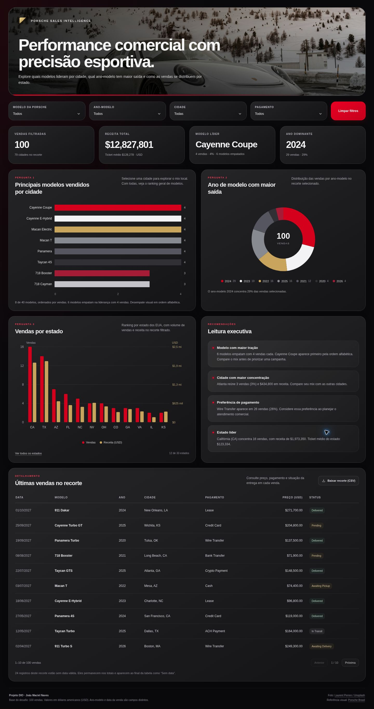
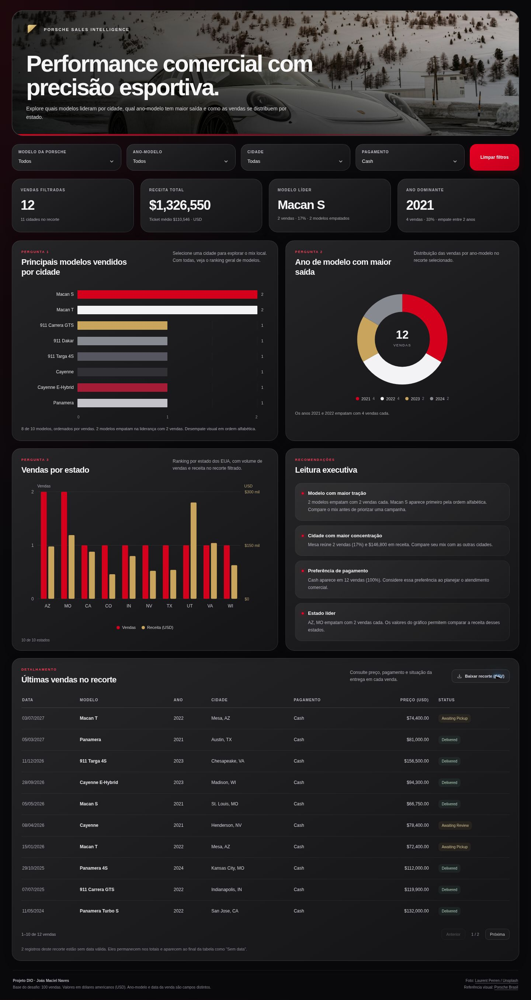

# Porsche Sales Intelligence

Dashboard interativo de vendas desenvolvido para o desafio da DIO, com autoria de **Joás Maciel Naves**. A base possui 100 vendas da Porsche. A interface segue as referências da aula: fotografia de abertura, fundo escuro, destaques em vermelho e dourado, filtros globais e três perguntas de negócio.

## Acessos

- [Repositório do projeto](https://github.com/DrTolansk/dio-dashboard-porsche)
- [Dashboard no GitHub Pages](https://drtolansk.github.io/dio-dashboard-porsche/) — disponível após publicar os arquivos e ativar Pages.
- Para abrir a versão local, baixe [index.html](index.html) e abra em um navegador com JavaScript habilitado.
- [Passo a passo de publicação pelo celular](COMO_PUBLICAR.md).

O HTML é um arquivo único: dados, fotografia, estilos e código estão embutidos. A execução não depende de instalação, servidor, bibliotecas externas ou requisições para carregar os gráficos.

## Perguntas de negócio

| Pergunta | Como o painel responde | Por que analisar |
|---|---|---|
| Quais modelos têm maior volume de vendas em cada cidade? | Ranking com barras horizontais; o filtro de cidade revela o mix local. Com todas as cidades, o ranking é geral. | Comparar a preferência registrada por região e orientar a avaliação do mix comercial. |
| Qual ano-modelo tem maior saída? | Gráfico de rosca por ano-modelo e indicador do ano dominante. | Entender a composição das vendas por ano do veículo. Ano-modelo é diferente do ano da venda. |
| Quais estados concentram vendas e receita? | Barras vermelhas para unidades e douradas para receita, com dois eixos identificados. | Comparar volume e valor comercial dos estados dos EUA representados na base. |

O ranking por estado mostra os 12 primeiros inicialmente. O botão **Ver todos os estados** permite consultar os 33 estados da base. O ranking de modelos mostra os oito primeiros do recorte.

## Indicadores e filtros

Os filtros **modelo, ano-modelo, cidade e pagamento** se combinam. Qualquer alteração atualiza indicadores, gráficos, leitura executiva, tabela e arquivo CSV exportado. **Limpar filtros** restaura a base completa.

| Indicador | Resultado na base completa |
|---|---:|
| Vendas registradas | 100 |
| Receita, com centavos preservados | US$ 12.827.800,50 |
| Ticket médio exato | US$ 128.278,005 |
| Cidades | 79 |
| Modelos distintos | 40 |
| Estados dos EUA | 33 |
| Ano-modelo com maior volume | 2024 — 29 vendas |
| Estado com mais vendas | CA — 16 vendas, US$ 1.973.350,00 |

Os indicadores de receita e ticket são apresentados em dólares inteiros para reproduzir a referência visual. A tabela e os arquivos da base preservam os centavos. Por isso, o indicador de receita mostra **$12,827,801**.

**Critério de empate:** ordenação por quantidade decrescente e nome em ordem alfabética. Existem seis modelos com quatro vendas cada: Cayenne Coupe, Cayenne E-Hybrid, Macan Electric, Macan T, Panamera e Taycan 4S. Cayenne Coupe aparece primeiro por esse critério, e o painel informa o empate. A mesma regra vale para ano-modelo, cidade, pagamento e estado.

A receita é a soma dos preços dos registros da base, mantendo todos os status de entrega, inclusive cancelamentos. Ela reproduz a agregação da aula; não representa uma apuração de caixa recebido ou de faturamento contábil.

## Preparação da base

A origem é a **Planilha base Porsche (sanitizada)** fornecida no desafio, aba **Sanitized**. Ela traz os campos brutos e os campos já tratados pelo curso. Esta implementação selecionou as versões sanitizadas e preparou os tipos para a análise.

1. Foram preservados os 100 registros e seus identificadores de venda.
2. Os campos sanitizados de modelo, cidade, estado, pagamento e status foram usados sem agrupar versões diferentes de um mesmo veículo.
3. Ano-modelo e preço foram convertidos de texto para números. No JavaScript, os preços são mantidos em **centavos inteiros**, evitando perda de precisão nas somas.
4. Datas ISO válidas foram mantidas. As 24 datas marcadas como INVALID viraram valores nulos no JSON e células vazias no Excel, identificadas como **Sem data**.
5. As vendas sem data continuam nos indicadores e nos agrupamentos por modelo, ano-modelo e estado. Na tabela, aparecem depois dos registros com data válida.
6. Os nomes de clientes e vendedores foram excluídos da base publicada. O arquivo original com esses campos não integra este repositório.
7. O Excel preparado contém valores, datas tipadas, preço e ano-modelo numéricos, tabela com filtro e cabeçalho congelado. Não há fórmulas a serem executadas para carregar o dashboard.

Os preços permanecem em **USD**, conforme os registros originais e o painel da aula. Não foi aplicada conversão para reais. As datas da base, inclusive as posteriores ao dia de criação do projeto, foram preservadas como material do desafio.

O campo de odômetro é apenas preservado como valor sanitizado da fonte. Os registros brutos usam unidades diferentes; esse campo não é usado em indicadores nem recebe uma unidade única presumida.

## Prompt de construção

O briefing abaixo consolida as orientações utilizadas na construção desta versão, a partir do desafio e das referências visuais da aula.

~~~text
Crie um dashboard interativo das 100 vendas da Porsche em um único
arquivo index.html, com HTML, CSS e JavaScript no próprio arquivo.

Use somente os campos sanitizados da planilha. Converta preço e
ano-modelo para números. Preserve todos os registros, mantenha os
valores em USD e represente datas INVALID como "Sem data".
Exclua nomes de clientes e vendedores da base publicada.

Filtros globais: modelo da Porsche, ano-modelo, cidade e pagamento.
Inclua um botão Limpar filtros. Filtros combinados devem atualizar
todos os indicadores, gráficos, recomendações e a tabela.

Perguntas:
1. Quais modelos são mais vendidos por cidade?
2. Qual ano-modelo tem maior saída?
3. Quais estados concentram volume de vendas e receita?

No topo, mostre vendas filtradas, receita total com ticket médio,
modelo líder e ano dominante. Indique empates reais sem inventar
uma liderança exclusiva.

Siga os prints da interface do professor: fotografia da Porsche nas
montanhas nevadas, título grande em branco, fundo preto e grafite,
cards arredondados, vermelho Porsche e detalhes dourados.
Use barras horizontais para modelos, rosca para ano-modelo e barras
agrupadas de vendas e receita para estados, com dois eixos claros.

Inclua leitura executiva derivada do recorte, tabela de últimas
vendas, paginação, informação ao focar ou tocar nos gráficos e
exportação CSV. Trate combinações sem resultados.

Adapte o layout ao celular. Preserve os cabeçalhos horizontais da
tabela e permita rolagem dentro dela. Incorpore imagem e dados no
HTML para funcionar também como arquivo local.
~~~

## Refinamentos até a versão entregue

- A terceira análise foi refinada para **vendas por estado**, seguindo a última versão mostrada pelo professor, após os exemplos anteriores de insights por cidade e evolução mensal.
- Os quatro filtros foram combinados em uma única seleção de registros para manter os componentes coerentes.
- Foram adicionadas mensagens de recorte vazio e tratamento de divisão por zero.
- Os cabeçalhos da tabela permanecem alinhados, com rolagem interna em telas estreitas.
- Empates são informados nos indicadores e nos textos da leitura executiva.
- Os centavos foram preservados na base e no detalhamento, apesar do arredondamento dos indicadores de topo.
- A tabela oferece dez registros por página. O CSV inclui **todo o recorte**, e não somente a página visível.
- A fotografia e os dados foram incorporados ao HTML. Os gráficos usam SVG e CSS nativos, com suporte a teclado e informações por foco ou toque.

## Ferramentas e escolha do caminho

Esta versão foi desenvolvida com assistência do **agente Codex no ChatGPT Work**, utilizando orientações das skills de **Sites** e **Spreadsheets** para implementação e preparação da planilha. Os prints do fluxo Canvas da aula serviram como referência visual e de comportamento.

A escolha do agente permitiu conferir o arquivo original, construir o HTML, preparar os arquivos de dados e testar as interações no navegador. Não foi executada uma segunda construção independente no Canvas nem uma comparação formal com um GPT personalizado.

Tecnologias do painel: **HTML, CSS, JavaScript e SVG**. Todos os cálculos apresentados são derivados dos registros embutidos. O arquivo JSON separado documenta a mesma base; alterá-lo isoladamente não atualiza a cópia incorporada ao HTML.

## Validação

Os cenários abaixo foram conferidos no navegador contra os dados da planilha:

| Cenário | Resultado conferido |
|---|---|
| Sem filtros | 100 vendas; 79 cidades; receita exata de US$ 12.827.800,50 |
| Cidade Albuquerque | 1 venda; US$ 198.300,00; modelo 911 Turbo; ano-modelo 2024 |
| Pagamento Cash | 12 vendas; 11 cidades; US$ 1.326.550,00 |
| Modelo 718 Boxster | 3 vendas; 3 cidades; US$ 219.400,00 |
| Ano-modelo 2024 | 29 vendas; US$ 4.740.800,00 |
| 718 Cayman + 2022 + Boston + Credit Card | 1 venda; US$ 79.500,00; data apresentada como Sem data |
| Albuquerque + Cash | Nenhuma venda; indicadores e gráficos mostram o estado vazio |
| Ver todos os estados | 33 estados disponíveis |
| Última página da tabela | Registros 91 a 100; botão Próxima desabilitado |
| Exportação CSV com Cash | 12 registros exportados; soma de US$ 1.326.550,00 |
| Limpar filtros | Retorno às 100 vendas e ao total da base |

O layout foi inspecionado em áreas de renderização de **360, 390 e 1440 pixels** no Chrome, incluindo ausência de transbordamento horizontal da página. O gráfico por estado e a tabela têm rolagem interna quando necessário. Nenhum erro de JavaScript do dashboard foi observado nos fluxos testados.

### Exemplo com filtro aplicado

### Interface em tela estreita

## Arquivos do projeto

| Arquivo | Conteúdo |
|---|---|
| [index.html](index.html) | Dashboard completo em arquivo único |
| [base_tratada.xlsx](base_tratada.xlsx) | Planilha preparada, com tipos numéricos e sem nomes pessoais |
| [base_tratada.csv](base_tratada.csv) | Mesma base em CSV UTF-8 com vírgula como separador |
| [vendas_tratadas.json](vendas_tratadas.json) | 100 registros usados na análise, com preços em centavos |
| [qualidade_dados.json](qualidade_dados.json) | Contagens, regras e decisões de preparação |
| [dashboard-desktop.jpg](dashboard-desktop.jpg) | Evidência da visão geral |
| [dashboard-filtro-cash.jpg](dashboard-filtro-cash.jpg) | Evidência de filtro aplicado |
| [dashboard-mobile.jpg](dashboard-mobile.jpg) | Evidência da interface em tela estreita |
| [COMO_PUBLICAR.md](COMO_PUBLICAR.md) | Orientações para enviar os arquivos e ativar o GitHub Pages |

## Referências

- Desafio da DIO e aulas de Felipe Aguiar: base, perguntas de exemplo, interface e fluxo de publicação.
- [Porsche Brasil](https://www.porsche.com/brazil/pt/): referência de identidade visual indicada na aula.
- [Fotografia de Laurent Perren no Unsplash](https://unsplash.com/photos/NeH9w4CdmnA), incorporada ao HTML sob a [licença Unsplash](https://unsplash.com/license).
- [Documentação do GitHub Pages](https://docs.github.com/en/pages/getting-started-with-github-pages/configuring-a-publishing-source-for-your-github-pages-site): configuração da publicação.
